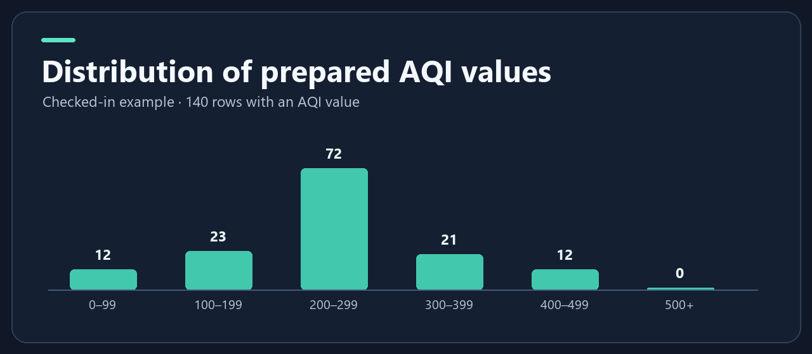

# Air Quality Prediction

Air-quality data preparation and exploration with a reproducible sample dataset.

**Tech stack** · Python · pandas · NumPy · scikit-learn · Jupyter



## From raw readings to clean features

`generate_dataset.py` produces synthetic Hyderabad-area readings with gaps, duplicates, and outliers. `preprocess_data.py` cleans the input and writes a CSV plus a short preprocessing report. The checked-in CSVs make it possible to inspect the workflow before generating a new sample.

| Piece | What to look at |
| --- | --- |
| Raw and prepared examples | [`aqi_data_raw.csv`](aqi_data_raw.csv) and [`aqi_data_preprocessed.csv`](aqi_data_preprocessed.csv) |
| Cleaning summary | [`aqi_data_preprocessed_report.txt`](aqi_data_preprocessed_report.txt) |
| Exploratory notebook | [`AQI (2).ipynb`](AQI/AQI%20%282%29.ipynb) and its [input workbook](AQI/bollaram.xlsx) |

## Quick start

```bash
python -m pip install -r requirements.txt
python preprocess_data.py
```

Run `python generate_dataset.py` first if you want a fresh synthetic sample. Both scripts write their outputs to the current directory. Run them in a scratch copy if you want to keep the checked-in examples intact. For the notebook, open `AQI/` as the notebook working folder so it can find `bollaram.xlsx`.

## Tests and verification

Run `python -m py_compile generate_dataset.py preprocess_data.py logisticregression.py scraper.py`. Open the preprocessing report to review missing values, removed duplicates, and the output row count. `logisticregression.py` is a separate Iris classifier exercise. `scraper.py` is a small pandas exercise. The AQI pipeline currently covers data preparation and exploration.

## License

The project code is available under the [MIT License](LICENSE).
